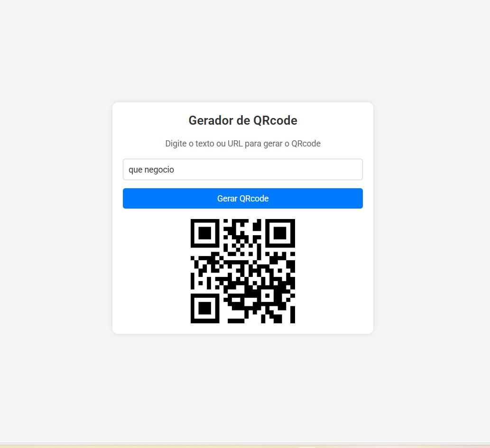

<div align="center">

#  QR— Gerador de QR Code Instantâneo

**Transformando links e textos em quadradinhos pretos misteriosos desde o último commit. **


</div>

---

##  Sobre o Projeto

Um gerador de QR Code minimalista, rápido e 100% funcional rodando direto no navegador. Feito com **HTML**, **CSS** e **JavaScript** puro para provar que não precisamos de um framework gigante para resolver problemas simples do dia a dia.

---

## 📸 Preview

> *(Dica: Tire um print da tela do seu projeto, suba na pasta do repositório e troque o link abaixo)*

<div align="center">
  
</div>

---

##  Funcionalidades

- [x] **Geração instantânea:** Digitou o texto ou link, clicou, virou QR Code.
- [x] **Download rápido:** Baixe a imagem gerada com um clique.
- [x] **Interface responsiva:** Funciona perfeitamente no PC e no celular.

---

##  Como rodar localmente
 É só baixar e abrir:

```bash
# 1. Clone o repositório
git clone https://github.com

# 2. Entre na pasta do projeto
cd NOME-DO-REPOSITORIO

# 3. Abra o arquivo index.html no seu navegador favorito!
```

---

## 🤝 Contribuindo

Achou um bug? Quer deixar o CSS mais bonito ou refatorar o JS? Sinta-se à vontade!

1. Faça um **Fork** do projeto
2. Crie uma Branch (`git checkout -b feature/MinhaMelhoria`)
3. Faça o **Commit** (`git commit -m 'Adiciona minha melhoria'`)
4. Faça o **Push** (`git push origin feature/MinhaMelhoria`)
5. Abra um **Pull Request**

---
